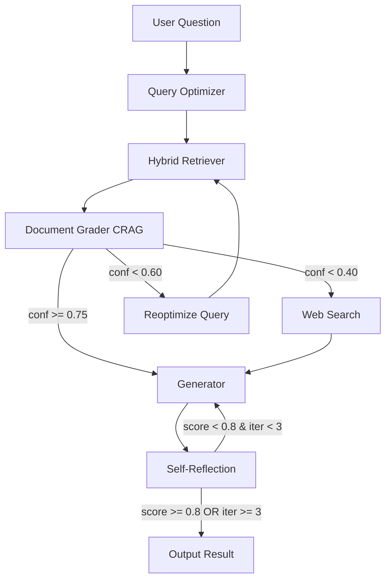

# Advanced Agentic RAG System for Thai Government Documents

Production-ready Retrieval Augmented Generation system implementing state-of-the-art accuracy improvements for Thai government official document (หนังสือราชการ) generation.

## 🎯 Key Features

### ✨ Core Improvements Over Basic RAG

1. **Corrective RAG (CRAG)** - Confidence-scored document grading with automatic corrective actions
2. **Hybrid Retrieval** - BM25 (sparse) + Dense vectors + Cohere Reranking
3. **Query Optimization** - Automatic query rewriting and enhancement
4. **Self-Reflection** - Quality validation before returning results
5. **Multi-Agent Architecture** - Specialized agents for each task
6. **RAGAS Evaluation** - Comprehensive accuracy metrics
7. **Error Handling** - Robust fallbacks and retry mechanisms

### 📊 Expected Performance Improvements

| Metric | Baseline | Enhanced | Improvement |
|--------|----------|----------|-------------|
| Retrieval Precision | ~60% | 85%+ | +25% |
| Answer Groundedness | 0.70 | 0.90+ | +20% |
| Factual Accuracy | ~70% | 90%+ | +20% |
| Format Compliance | ~75% | 95%+ | +20% |

## 🏗️ Architecture

### System Flow Diagram

```
┌─────────────────────────────────────────────────────────────────┐
│                      START: User Question                        │
└────────────────────────┬────────────────────────────────────────┘
                         │
                         ▼
┌─────────────────────────────────────────────────────────────────┐
│  Agent 1: Query Optimizer                                        │
│  • Rewrite query for clarity                                     │
│  • Add relevant keywords                                         │
│  • Identify document type                                        │
└────────────────────────┬────────────────────────────────────────┘
                         │
                         ▼
┌─────────────────────────────────────────────────────────────────┐
│  Agent 2: Hybrid Retriever                                       │
│  • BM25 Retrieval (k=50)        ┐                               │
│  • Dense Retrieval (k=50)       ├─→ Reciprocal Rank Fusion      │
│  • Cohere Rerank (top_k=10)     ┘                               │
└────────────────────────┬────────────────────────────────────────┘
                         │
                         ▼
┌─────────────────────────────────────────────────────────────────┐
│  Agent 3: Document Grader (CRAG)                                 │
│  • Grade each doc with confidence (0.0-1.0)                     │
│  • Calculate average confidence                                  │
│  • Determine corrective action:                                  │
│    - confidence < 0.40 → Web Search                             │
│    - confidence < 0.60 → Query Rewrite                          │
│    - confidence >= 0.75 → Proceed to Generation                 │
└────────────┬───────────────┬───────────────┬───────────────────┘
             │               │               │
    conf < 0.40    conf < 0.60      conf >= 0.75
             │               │               │
             ▼               ▼               ▼
    ┌────────────┐  ┌────────────┐  ┌────────────────────┐
    │ Web Search │  │  Reoptimize│  │  Agent 5: Generator│
    │            │  │   Query    │  │                    │
    └──────┬─────┘  └──────┬─────┘  └────────┬───────────┘
           │               │                  │
           └───────────────┴──────────────────┘
                          │
                          ▼
         ┌─────────────────────────────────────────┐
         │  Agent 6: Self-Reflection (Validator)   │
         │  • Validate format correctness          │
         │  • Check content accuracy               │
         │  • Verify language quality              │
         │  • Assess completeness                  │
         │  • Calculate overall score              │
         └────────────┬─────────────┬──────────────┘
                      │             │
              score < 0.8    score >= 0.8
              (iteration < 3)       │
                      │             │
                      ▼             ▼
              ┌─────────────┐  ┌────────┐
              │ Regenerate  │  │  END   │
              └─────────────┘  └────────┘
```

### Agent Responsibilities

| Agent | Purpose | Input | Output |
|-------|---------|-------|--------|
| **Query Optimizer** | Enhance query for better retrieval | User question | Optimized query, keywords, doc type |
| **Hybrid Retriever** | Retrieve relevant documents | Optimized query | Reranked documents |
| **Document Grader** | Assess document relevance with CRAG | Documents + query | Confidence scores, routing decision |
| **Web Search** | Fallback when docs insufficient | Query | Web search results |
| **Generator** | Create Thai gov document | Filtered docs + query | Generated document |
| **Reflection Validator** | Validate output quality | Generated doc + context | Quality scores, regeneration decision |

## 📦 Installation

### Prerequisites

- Python 3.10+
- UV package manager (recommended) or pip
- API Keys:
  - DeepSeek API key (for document grading and validation)
  - Cohere API key (for embeddings and reranking)
  - Tavily API key (for web search)

### Setup

```bash
# Clone repository
cd /path/to/agent

# Create .env file with API keys
cat > .env << EOF
DEEPSEEK_API_KEY=your_deepseek_key
COHERE_API_KEY=your_cohere_key
TAVILY_API_KEY=your_tavily_key
LANGCHAIN_API_KEY=your_langchain_key  # Optional
LANGCHAIN_PROJECT=agentic_rag_production
EOF

# Install dependencies with UV
source .venv/bin/activate
uv pip install -r requirements.txt

# Verify Ollama is running with Typhoon model
ollama list | grep typhoon
# If not installed:
# ollama pull hf.co/dearxoasis/llama3.2-typhoon2-3b-instruct_2705:Q8_0
```

## 🚀 Usage

### Basic Usage

```python
# Run the main script
uv run corrective_rag_web_search.py
```

### Advanced Usage

```python
from corrective_rag_web_search import app

# Prepare input
input_state = {
    "question": "เขียนหนังสือบันทึกข้อความ ขออนุมัติเดินทางตรวจตามแผน",
    "reflection_iteration": 0,
    "web_search_needed": False,
    "query_rewrite_needed": False,
    "regeneration_needed": False,
    "warnings": []
}

# Stream execution
for output in app.stream(input_state):
    for node_name, node_output in output.items():
        print(f"Node '{node_name}' completed")

# Access final result
final_state = node_output
generated_doc = final_state['generation']
quality_score = final_state['quality_score']
quality_assessment = final_state['quality_assessment']
```

### Running Evaluation

```python
from evaluation import BenchmarkRunner, THAI_GOV_DOC_TEST_CASES
from corrective_rag_web_search import app

# Create benchmark runner
runner = BenchmarkRunner(app)

# Run benchmark
results = runner.run_benchmark(
    test_cases=THAI_GOV_DOC_TEST_CASES,
    save_results=True
)

# View RAGAS metrics
print(results)
```

## ⚙️ Configuration

All settings are centralized in [config.py](config.py):

### Key Configuration Parameters

```python
# Retrieval
DENSE_RETRIEVAL_K = 50        # Dense retrieval results
BM25_RETRIEVAL_K = 50          # BM25 retrieval results
RERANK_TOP_K = 10              # After reranking
FINAL_CONTEXT_K = 5            # Final docs for generation

# CRAG Thresholds
HIGH_CONFIDENCE_THRESHOLD = 0.75   # Direct to generation
LOW_CONFIDENCE_THRESHOLD = 0.60    # Trigger query rewrite
VERY_LOW_THRESHOLD = 0.40          # Trigger web search

# Self-Reflection
MAX_REFLECTION_ITERATIONS = 3      # Max regeneration attempts
REFLECTION_THRESHOLD = 0.8         # Min quality score to accept

# Models
GENERATION_MODEL = "hf.co/dearxoasis/llama3.2-typhoon2-3b-instruct_2705:Q8_0"
GRADING_MODEL = "deepseek-chat"  # DeepSeek for grading & validation
EMBEDDING_MODEL = "embed-multilingual-v3.0"
RERANK_MODEL = "rerank-multilingual-v3.0"
```

## 📋 State Schema

The enhanced `GraphState` tracks comprehensive information:

```python
class GraphState(TypedDict):
    # Query
    question: str
    optimized_query: Optional[str]
    query_type: Optional[str]
    additional_keywords: Optional[List[str]]

    # Retrieval
    documents: List[Document]
    filtered_docs: List[Document]
    reranked_docs: List[Document]

    # Grading (CRAG)
    doc_grades: List[Dict]
    average_confidence: Optional[float]

    # Generation
    generation: Optional[str]

    # Self-Reflection
    quality_score: Optional[float]
    quality_assessment: Optional[Dict]
    reflection_iteration: Annotated[int, operator.add]

    # Control Flow
    web_search_needed: bool
    query_rewrite_needed: bool
    regeneration_needed: bool

    # Metadata
    retrieval_method: Optional[str]
    error: Optional[str]
    warnings: Annotated[List[str], operator.add]
```

## 📊 Evaluation Metrics (RAGAS)

The system includes comprehensive evaluation using RAGAS framework:

### Metrics Tracked

1. **Faithfulness** (0-1)
   - Measures factual accuracy against retrieved documents
   - Detects hallucinations

2. **Answer Relevancy** (0-1)
   - How well the answer addresses the question
   - Penalizes irrelevant information

3. **Context Precision** (0-1)
   - Precision of retrieved documents
   - Are the top results relevant?

4. **Context Recall** (0-1)
   - Completeness of retrieved information
   - Did we retrieve all relevant information?

### Running Evaluation

```bash
# Run benchmark with test cases
python evaluation.py

# Results saved to ./evaluation_results/
# - ragas_eval_YYYYMMDD_HHMMSS.json
# - benchmark_detail_YYYYMMDD_HHMMSS.csv
```

## 🔧 Troubleshooting

### Common Issues

**1. Ollama model not found**
```bash
ollama pull hf.co/dearxoasis/llama3.2-typhoon2-3b-instruct_2705:Q8_0
```

**2. API key errors**
```bash
# Verify .env file
cat .env

# Check keys are loaded
python -c "from config import validate_config; validate_config()"
```

**3. Import errors**
```bash
# Reinstall dependencies
uv pip install -r requirements.txt --force-reinstall
```

**4. RAGAS evaluation fails**
- RAGAS requires OpenAI-compatible API for evaluation metrics
- Ensure `DEEPSEEK_API_KEY` is set in `.env`
- Check API quota and rate limits
- Note: DeepSeek uses OpenAI-compatible API endpoints

## 📈 Performance Optimization

### Tips for Better Performance

1. **Adjust chunk size** - Smaller chunks (512-1024) for precise retrieval
2. **Tune reranking** - Increase `RERANK_TOP_K` if missing relevant docs
3. **Lower confidence thresholds** - If too many query rewrites, adjust `LOW_CONFIDENCE_THRESHOLD`
4. **Reduce reflection iterations** - Set `MAX_REFLECTION_ITERATIONS = 1` for faster generation
5. **Use GPU FAISS** - Replace `faiss-cpu` with `faiss-gpu` in requirements.txt

## 🔄 Workflow Diagram (Mermaid)



## 📚 References

### Research Papers

- **Corrective RAG (CRAG)**: "Corrective Retrieval Augmented Generation" (arXiv:2401.15884)
- **Self-RAG**: "Self-RAG: Learning to Retrieve, Generate, and Critique" (arXiv:2310.11511)
- **RAGAS**: "RAGAS: Automated Evaluation of Retrieval Augmented Generation" (arXiv:2309.15217)
- **Hybrid Search**: Recent research on BM25 + Dense retrieval fusion (2024-2025)

### Tools & Frameworks

- [LangGraph](https://github.com/langchain-ai/langgraph) - Agent orchestration
- [LangChain](https://github.com/langchain-ai/langchain) - LLM framework
- [RAGAS](https://github.com/explodinggradients/ragas) - RAG evaluation
- [Cohere Rerank](https://docs.cohere.com/docs/reranking) - Document reranking

## 🤝 Contributing

This is a research project for Thai government document generation. Contributions welcome:

1. Improved prompt engineering for Thai language
2. Better document chunking strategies
3. Additional evaluation metrics
4. Performance optimizations

## 📝 License

[Your License Here]

## 👥 Authors

[Your Name/Team]

---

**Last Updated**: 2025-09-30

**Version**: 2.0.0 (Advanced Agentic RAG)